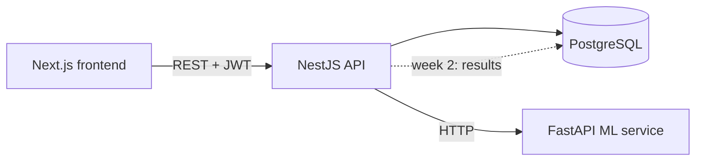

# Architecture

## Design decisions

- **ML is a separate service.** The ML code evolves independently (Python
  libraries, model files) and the API stays a thin, typed gateway.
- **Every matcher returns the same `MatchResponse` shape** (score, per-requirement
  evidence, missing list), so keyword, embeddings and LLM matchers can be swapped
  and compared in the evaluation.
- **Every query is scoped by `userId`** in the applications service.
- **`synchronize: true` is dev-only.** Move to TypeORM migrations before deploying.

## ML service contract

`POST /extract` `{ text, kind?: "job_description"|"resume", method?: "keyword"|"llm" }` ->
`{ skills, extractor, details: [{ name, importance, quote }], dropped, usage }`
(`method` defaults to `keyword`, which is free and deterministic.)

`POST /match` `{ resume_text, job_description }` ->
`{ matcher, score, requirements: [{ requirement, supported, evidence: [{ line, line_number }] }], missing }`

`POST /parse/pdf` raw PDF bytes (`Content-Type: application/pdf`) -> `{ text, pages }`.
Line breaks are preserved because the matcher cites resume lines as evidence.
400 = not a PDF; 422 = encrypted, corrupted, too many pages (>30) or no extractable text (scanned).

## Resume upload flow

Browser -> `POST /resumes` (multipart, field `file`) -> NestJS checks the file by content (`%PDF-` magic bytes,
not the filename) -> PDFs go to the ML service for text extraction, `.txt` is read directly -> text is stored
in Postgres with the `userId`. Matching uses the stored text: `POST /match/by-ids { resumeId, applicationId }`.

## LLM extraction design

- **Grounded:** every skill must come with a quote copied from the input. Items whose quote is not found in
  the text (ignoring case and whitespace) are dropped and counted in `dropped`, so a hallucinated skill never
  reaches the matcher. `dropped` is also a useful number for your evaluation.
- **Forced tool call:** the model can only answer through a `record_skills` tool with a JSON schema.
- **Untrusted input:** resumes and job descriptions are wrapped in `<document>` tags and the model is told to
  ignore instructions inside them. Treat this as damage limitation, not a guarantee.
- **Aliases are canonicalized** to the same vocabulary the keyword baseline uses ("ReactJS" -> "React"), so the
  two extractors can be compared on equal terms.
- **Errors:** no API key -> 503 (no silent fallback, so evaluation runs never mix extractors);
  provider error -> 502 without leaking details.
- **Not deterministic:** the SDK call has no temperature setting, so results can vary slightly between runs.
  For the evaluation, run each input a few times or cache results.

## Service-to-service security

The ML service is publicly reachable on free hosting, and `/extract?method=llm` can spend LLM budget.
The backend sends `X-API-Key: $ML_API_KEY` and the ML service rejects other callers with 401 (`/health` stays open).
If `ML_API_KEY` is unset the check is disabled, which is only meant for local development.

## Hosting model (Vercel + Neon)

Three Vercel projects from one repo (`frontend`, `backend`, `ml-service`) and Neon Postgres. The backend and ML service
run as single serverless functions, so there is no long-lived process: no in-process queue, small DB pools
(`DB_POOL_MAX`), request timeouts towards the ML service (`ML_TIMEOUT_MS`), a 4 MB upload cap (Vercel documents a
4.5 MB request-body limit), and tables are created once from a developer machine rather than on startup.
The Dockerfiles and `docker-compose.yml` are for local development.

## Saved match results

`POST /applications/:id/matches { resumeId }` runs the match inside the request (no queue: serverless functions cannot
keep working after responding) and stores a `match_results` row: matcher name, score, per-requirement evidence (jsonb)
and a snapshot of the resume filename. Deleting an application cascades to its results; deleting a resume keeps them
(`resumeId` becomes null, the filename remains). Every lookup is scoped by `userId`.
The `matcher` column is what the week 3 evaluation uses to compare keyword, TF-IDF and LLM matchers on the same inputs.

## AI (LLM) matcher

`POST /match { matcher: "llm" }` (ML service) asks the model to list the job description's requirements and say which
numbered resume lines support each one. The model returns **line numbers only**; the evidence text is looked up from
the resume, so a quote can never be invented. A "supported" claim with no real line number is downgraded to
"not supported" and counted in `ungrounded`; evidence attached to an unsupported requirement is discarded.
What is not verified is whether a real line truly supports the requirement; that is the model's judgement and is what
the week 3 evaluation measures. The score counts every requirement equally (`importance` is stored for later weighting).

Cost control: the backend caps AI matches per user and overall over a rolling 24 hours (`LLM_MATCH_DAILY_LIMIT`,
`LLM_MATCH_GLOBAL_DAILY_LIMIT`), counted from saved results; texts over 30,000 characters are rejected; failed calls
are not saved and do not use quota. Without a provider key (`GEMINI_API_KEY` or `ANTHROPIC_API_KEY`) the ML service answers 503 and the backend shows a
neutral "AI matcher is not available" message.

## TF-IDF matcher

`POST /match { matcher: "tfidf" }` (ML service): free, deterministic, pure Python (no scikit-learn or numpy, which would
not fit Vercel's 250 MB function limit and are not needed at this text size). Steps:

1. The job description is split into requirement units (list items, comma/"and" parts, sentences). Section headings
   decide importance and what to skip ("Requirements" and "Responsibilities" are required, "Nice to have" is preferred,
   "About us" and "Benefits" are skipped). Without headings, only lines with a known skill, a requirement cue word
   ("experience", "proficiency", ...) or a short list item count. This is a heuristic, not a parser.
2. Units and resume lines become sets of terms: lower-cased, stop words and lead-ins such as "we need someone with" removed,
   light suffix stemming, skill aliases normalised ("ReactJS" to "react"), a few irregular verbs ("built" to "build").
3. Each term gets an IDF weight computed over all resume lines and units as documents, so common words weigh little and
   rare ones (selenium, terraform) weigh a lot.
4. A unit is supported when one resume line contains at least `TFIDF_THRESHOLD` (default 0.6) of the unit's total weight.
   The best lines (up to 3) are the evidence; the score is the share of units supported.
5. Resume lines that only say the person is "curious about" or "wants to learn" something are never used as evidence.
   (The keyword matcher has no such rule and will count them: a known weakness of the baseline.)

Also returned: `doc_similarity`, the classic TF-IDF cosine between the whole resume and the whole job description.
It is shown for reference and not used for the score.

Known limits: no synonyms ("REST services" does not support "API design"), soft skills such as "communication" almost
always show as missing, and unusual job-description layouts can produce odd units. The threshold is a starting value,
not a tuned one: week 3 should tune it on a labeled set and report the chosen value.

## LLM provider

Two providers are supported: Google Gemini (free tier available) and Anthropic (paid). `LLM_PROVIDER` picks one; with only
one key set it is chosen automatically. The extractor and the LLM matcher were written against the Anthropic client
(`client.messages.create` with a forced tool), so Gemini is plugged in through `app/gemini_adapter.py`, which accepts the
same call, asks Gemini for JSON that follows the tool's schema (structured output), and returns a reply in the same shape.
Grounding, limits and error handling are therefore identical for both. Provider errors are reported to the backend as
"LLM request failed (<ErrorClass> <status>)", never with the provider's message, which can contain secrets.
Free-tier Gemini content may be used by Google to improve its products (see `DEPLOY.md`).
