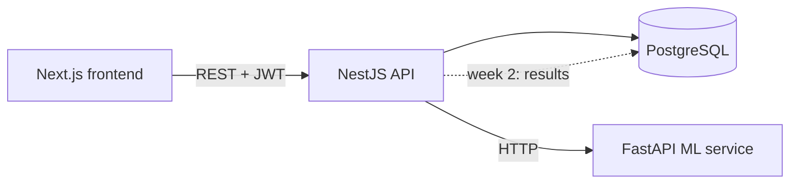

# Architecture

## Design decisions

- **ML is a separate service.** The ML code evolves independently (Python
  libraries, model files) and the API stays a thin, typed gateway.
- **Every matcher returns the same `MatchResponse` shape** (score, per-requirement
  evidence, missing list), so keyword, embeddings and LLM matchers can be swapped
  and compared in the evaluation.
- **Every query is scoped by `userId`** in the applications service.
- **`synchronize: true` is dev-only.** Move to TypeORM migrations before deploying.

## ML service contract

`POST /extract` `{ text, kind?: "job_description"|"resume", method?: "keyword"|"llm" }` ->
`{ skills, extractor, details: [{ name, importance, quote }], dropped, usage }`
(`method` defaults to `keyword`, which is free and deterministic.)

`POST /match` `{ resume_text, job_description }` ->
`{ matcher, score, requirements: [{ requirement, supported, evidence: [{ line, line_number }] }], missing }`

`POST /parse/pdf` raw PDF bytes (`Content-Type: application/pdf`) -> `{ text, pages }`.
Line breaks are preserved because the matcher cites resume lines as evidence.
400 = not a PDF; 422 = encrypted, corrupted, too many pages (>30) or no extractable text (scanned).

## Resume upload flow

Browser -> `POST /resumes` (multipart, field `file`) -> NestJS checks the file by content (`%PDF-` magic bytes,
not the filename) -> PDFs go to the ML service for text extraction, `.txt` is read directly -> text is stored
in Postgres with the `userId`. Matching uses the stored text: `POST /match/by-ids { resumeId, applicationId }`.

## LLM extraction design

- **Grounded:** every skill must come with a quote copied from the input. Items whose quote is not found in
  the text (ignoring case and whitespace) are dropped and counted in `dropped`, so a hallucinated skill never
  reaches the matcher. `dropped` is also a useful number for your evaluation.
- **Forced tool call:** the model can only answer through a `record_skills` tool with a JSON schema.
- **Untrusted input:** resumes and job descriptions are wrapped in `<document>` tags and the model is told to
  ignore instructions inside them. Treat this as damage limitation, not a guarantee.
- **Aliases are canonicalized** to the same vocabulary the keyword baseline uses ("ReactJS" -> "React"), so the
  two extractors can be compared on equal terms.
- **Errors:** no API key -> 503 (no silent fallback, so evaluation runs never mix extractors);
  provider error -> 502 without leaking details.
- **Not deterministic:** the SDK call has no temperature setting, so results can vary slightly between runs.
  For the evaluation, run each input a few times or cache results.

## Service-to-service security

The ML service is publicly reachable on free hosting, and `/extract?method=llm` can spend LLM budget.
The backend sends `X-API-Key: $ML_API_KEY` and the ML service rejects other callers with 401 (`/health` stays open).
If `ML_API_KEY` is unset the check is disabled, which is only meant for local development.

## Hosting model (Vercel + Neon)

Three Vercel projects from one repo (`frontend`, `backend`, `ml-service`) and Neon Postgres. The backend and ML service
run as single serverless functions, so there is no long-lived process: no in-process queue, small DB pools
(`DB_POOL_MAX`), request timeouts towards the ML service (`ML_TIMEOUT_MS`), a 4 MB upload cap (Vercel documents a
4.5 MB request-body limit), and tables are created once from a developer machine rather than on startup.
The Dockerfiles and `docker-compose.yml` are for local development.

## Saved match results

`POST /applications/:id/matches { resumeId }` runs the match inside the request (no queue: serverless functions cannot
keep working after responding) and stores a `match_results` row: matcher name, score, per-requirement evidence (jsonb)
and a snapshot of the resume filename. Deleting an application cascades to its results; deleting a resume keeps them
(`resumeId` becomes null, the filename remains). Every lookup is scoped by `userId`.
The `matcher` column is what the week 3 evaluation uses to compare keyword, TF-IDF and LLM matchers on the same inputs.
